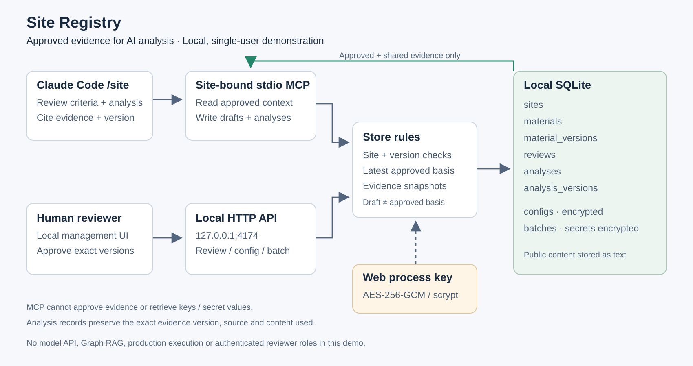
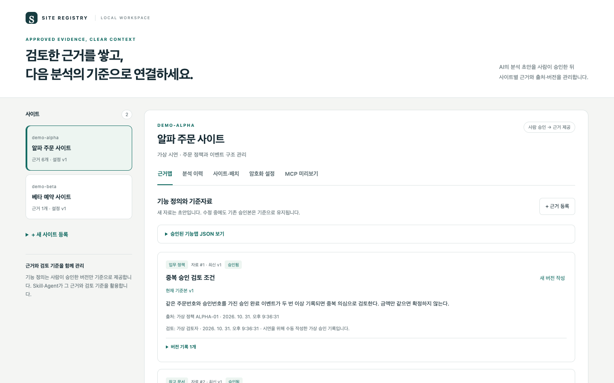

# Site Registry

**사람이 승인한 업무 근거와 검토 기준을 사이트별로 관리하고, AI 분석에 제공하는 로컬 미니 프로젝트**입니다.

AI가 기능 정의 초안을 만들고 사람이 검토·승인하면, 그 버전이 근거 맵의 기준이 됩니다. 이후 `/site` Skill은 승인 근거를 요구사항·리스크 검토의 기준으로 활용하고, 분석 결과에 사용한 근거의 버전과 출처를 남깁니다. 회사 코드나 실제 업무 데이터를 공개하지 않고 구조를 설명하기 위해 새로 작성한 가상 구현입니다.



## 바로 실행하기

Node.js **24.x**가 필요합니다. 외부 패키지 설치나 AI 계정 없이 웹 데모를 실행할 수 있습니다.

```sh
git clone https://github.com/dev-Rluan/site-registry.git
cd site-registry
npm run demo
```

브라우저에서 <http://127.0.0.1:4174>에 접속합니다. 종료는 `Ctrl+C`입니다. 포트가 사용 중이면 `PORT=4175 npm run demo`로 변경합니다.

- `npm run demo`: 가상 사이트·정책·기능·승인·분석 예시를 생성합니다.
- `npm start`: 직접 입력할 별도 저장소로 시작합니다.
- `npm test`: 저장, 승인, 사이트 경계, 암호화, MCP, HTTP 흐름을 검사합니다.

데모는 모델을 호출하지 않습니다. 표시되는 AI 분석 예시와 승인 기록은 **사람이 미리 작성한 가상 데이터**입니다. 실제 Claude Code의 `/site` 사용에는 별도 계정과 연결 설정이 필요합니다.

## 무엇을 확인할 수 있나요?

| 영역 | 구현 범위 |
|---|---|
| 근거 관리 | 기능 정의, 검토 기준, 업무 정책, 참고 문서, JSON 원데이터의 5종류 |
| 사람의 검토 | 최신 초안의 특정 버전을 승인 또는 반려. 검토자·의견·시각 기록 |
| 기준본 선택 | **가장 높은 승인 버전이 공유 상태일 때만** 제공. 새 초안·반려본이 기존 승인본을 바꾸지 않음 |
| 기능맵 | 승인 근거 노드와 기능 JSON의 `related_ids` 관계. JSON 조회·다운로드 |
| 분석 이력 | 요청, 요구사항/리스크 구분, 결과, 출처, 분석 버전과 참조 근거 스냅샷 |
| 사이트·배치 | 사이트별 공개 업무 정보와 배치 메타데이터. 비밀 설정은 암호화 저장 |
| MCP | 승인 근거 조회 3개, 초안·분석 저장 2개 도구. 사이트별로 연결 고정 |
| Skill | `/site 초안`, `/site 요구사항`, `/site 리스크`, `/site 기능갱신` 절차 예시 |

검토자 이름은 사용자가 입력하는 기록입니다. 로그인이나 사용자 신원 확인이 없으므로, 조직의 승인 권한을 보장하는 시스템으로 설명하지 않습니다.

## 5분 데모



1. **알파 주문 사이트**에서 기능 정의를 봅니다. 최신 저장본은 `v2 초안`, 기준본은 `v1 승인`입니다.
2. MCP 미리보기와 기능맵에서 **v1만 기준으로 제공**되는지 확인합니다.
3. v2 내용을 읽고 검토자와 의견을 입력해 승인합니다. 다시 조회하면 기준본이 v2가 됩니다.
4. 분석 기록을 확인합니다. 이전 분석은 사용 당시의 v1 내용·출처를 계속 보관합니다.
5. 베타 사이트로 바꿔 알파의 근거·배치가 섞이지 않는지 확인합니다.

상세 입력 예시는 [데모 따라하기](docs/demo-walkthrough.md)에 있습니다. 가상 승인도 실제 사용자가 화면에서 검토하는 절차를 연습하기 위한 것입니다.

## Claude Code에서 /site 사용하기

웹 서버와 stdio MCP 프로세스는 같은 SQLite 파일을 사용합니다. MCP는 HTTP 서버가 아니며, 로컬 웹 화면이 닫혀 있어도 저장된 자료를 사용할 수 있습니다.

1. `npm run demo`를 먼저 한 번 실행해 가상 자료를 만듭니다.
2. `examples/.mcp.json.example`을 작업 프로젝트의 `.mcp.json`으로 복사합니다. Node, `mcp.js`, 데이터 폴더를 실제 **절대 경로**로 바꿉니다.
3. `SITE_REGISTRY_SITE`를 `demo-alpha` 또는 `demo-beta`로 지정합니다. 도구 인자로 사이트를 변경할 수 없습니다.
4. `examples/site/SKILL.md`를 작업 프로젝트의 `.claude/skills/site/SKILL.md`로 복사합니다.
5. Claude Code에서 연결과 도구 사용 권한을 확인하고 `/site 요구사항 금액이 같은 승인 이벤트를 모두 중복으로 판단해도 되는가?`처럼 실행합니다.

| MCP 도구 | 역할 |
|---|---|
| `list_sites` | 연결된 사이트 한 곳의 정보 조회 |
| `get_site_context` | 승인 근거·검토 기준과 공개 배치 정보 조회 |
| `get_feature_map` | 승인된 근거 노드·기능 정의·참조 관계 조회 |
| `save_evidence_draft` | 사람이 검토할 새 초안 또는 수정 초안 저장 |
| `record_analysis` | 승인된 정확한 근거 버전을 연결해 분석 기록 저장 |

**MCP는 초안·분석을 쓸 수 있지만 승인할 수 없습니다.** 키를 읽거나 설정을 복호화하는 도구도 없습니다. 사람의 승인은 로컬 웹 화면에서 수행합니다. 새 기능 정의가 저장되어도 승인 전에는 AI의 기준 자료로 제공되지 않습니다.

연결 절차와 경계는 [MCP 워크플로](docs/mcp-workflow.md)를 참고하세요. 실제 Claude Code에서 `/site` 근거 조회와 분석 저장을 확인했고, 가상 8문항으로 두 입력 조건을 비교했습니다. 결과와 한계는 [효율 검증 보고서](docs/evaluation.md)에 기록했습니다. MCP는 2025-11-25 규격의 초기화·도구·newline stdio에 필요한 작은 범위를 직접 구현했습니다.

## 저장소와 이전 버전 데이터

`.data/demo.sqlite`와 `.data/registry.sqlite`는 분리됩니다. `SITE_REGISTRY_DATA_DIR`로 저장 폴더를 변경할 수 있습니다.

기존 v0.1 데이터는 삭제하지 않습니다. 추가 테이블이 생성되며 기존 자료는 **검토 기록이 없는 미승인 자료**로 유지됩니다. 사람이 검토·승인하기 전까지 MCP 기준 자료에 나타나지 않습니다. 데모 초기화는 빈 저장소에서만 수행되므로, 이전 데모 DB가 있으면 새 예시가 자동 추가되지 않습니다.

기존 데이터를 보존하면서 새 데모를 보려면 새 폴더를 지정합니다.

```sh
SITE_REGISTRY_DATA_DIR="$PWD/.data/demo-v2" npm run demo
```

이 폴더를 MCP에서도 사용하려면 `.mcp.json`의 데이터 폴더 경로를 똑같이 맞춥니다. 이미 예시를 수정한 뒤 다시 시작해도 변경 내용은 유지됩니다.

## 암호화와 공개 범위

- config JSON 전체와 배치의 `secrets`를 AES-256-GCM으로 암호화합니다. 무작위 salt/IV, scrypt 키 파생, 사이트·버전 또는 배치 식별자를 인증 데이터에 사용합니다.
- 첫 웹 실행 시 `.data/master.key`를 생성하며 파일 권한은 `0600`입니다. `SITE_REGISTRY_KEY`에 32자 이상 값을 주면 환경 변수 키를 사용합니다. 같은 데이터에는 같은 키가 필요합니다.
- config·배치의 비밀 원문을 반환하는 UI/API/MCP는 없습니다. MCP는 키를 읽지 않고 등록 여부와 공개 메타데이터만 조회합니다.
- 사이트 이름, 근거 본문, 출처, 검토·분석 이력은 평문입니다. 공유·승인된 자료는 연결한 AI에 전달될 수 있습니다. 근거 본문에는 비밀값을 넣지 않습니다.
- `.data/`는 Git에서 제외합니다. 키 파일을 DB 옆에 두는 편의 구조이며, 같은 사용자 권한으로 파일 전체에 접근하는 프로그램을 격리하지 않습니다.
- 웹 서버는 `127.0.0.1`에만 바인딩하고 Host/Origin을 확인합니다. 외부 공개 서비스용 인증·역할별 권한·KMS·키 회전은 구현하지 않았습니다.

## 구현한 범위와 남겨 둔 범위

이 구현의 중심은 **근거의 승인 상태와 버전, 사이트 범위, 분석 출처의 연결**입니다. 기능맵은 JSON 관계 구조이며 Graph DB나 RAG 검색 엔진이 아닙니다. 모델 API, 자동 코드 분석 엔진, 자동 리스크 판정, 배치 실행, 운영 변경과 롤백은 포함하지 않습니다. Skill은 AI가 따를 절차를 정의하며 결과의 정확성을 보장하는 실행 엔진이 아닙니다.

## 코드 읽기

- `store.js`: SQLite 모델, 입력 검증, 승인 기준본 선택, 근거 스냅샷, 암호화
- `server.js`, `public/`: 사람의 자료 등록·검토·승인을 위한 로컬 API와 화면
- `mcp.js`: 사이트에 고정한 5개 stdio 도구. 초안·분석 쓰기만 허용
- `examples/`: 프로젝트 연결 설정과 `/site` Skill
- `test/`: 저장·승인·경계·암호화·실제 stdio/HTTP 검증

[아키텍처와 데이터 모델](docs/architecture.md) · [데모 따라하기](docs/demo-walkthrough.md) · [검증과 한계](docs/verification.md)

## 동작과 효율 측정하기

`npm run benchmark`로 가상 자료 10/100/500개의 실제 HTTP·stdio MCP 응답 속도와 승인본 선별 전후의 자료량을 측정합니다. `npm run eval:prepare`는 모델 호출 없이 A/B 질문과 근거 경계를 검사합니다.

실제 모델 비교에는 로그인한 Claude Code가 필요합니다. `npm run smoke:claude`는 `/site`와 MCP 조회·분석 저장을, `npm run eval:claude -- --run`은 같은 모델의 8문항 × 2조건을 실행합니다. 설정된 계정 사용량을 소비하며, 호출당 CLI 비용 추정 상한은 smoke $0.80, A/B $0.50입니다. 비용 추정은 실제 청구액과 다를 수 있습니다.

로컬 성능 측정과 실제 Claude Code 연동, 8문항 × 2조건의 모델 비교를 완료했습니다. 측정 결과·재현 방법·판정 기준은 [동작·성능·AI 효율 검증](docs/evaluation.md)에 구분해 두었습니다.

## 공식 참고 문서

[MCP Tools](https://modelcontextprotocol.io/specification/2025-11-25/server/tools), [stdio](https://modelcontextprotocol.io/specification/2025-11-25/basic/transports), [초기화](https://modelcontextprotocol.io/specification/2025-11-25/basic/lifecycle), [Claude Code MCP](https://code.claude.com/docs/en/mcp), [Claude Code Skills](https://code.claude.com/docs/en/skills).

## 라이선스

소스는 [MIT License](LICENSE)를 따릅니다. 모든 데모 업무 정보와 설정값은 가상입니다.
