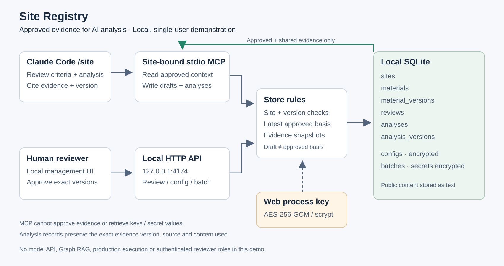
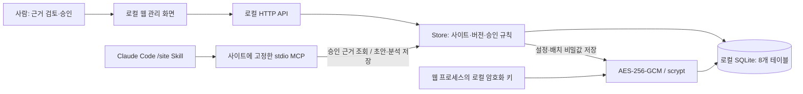
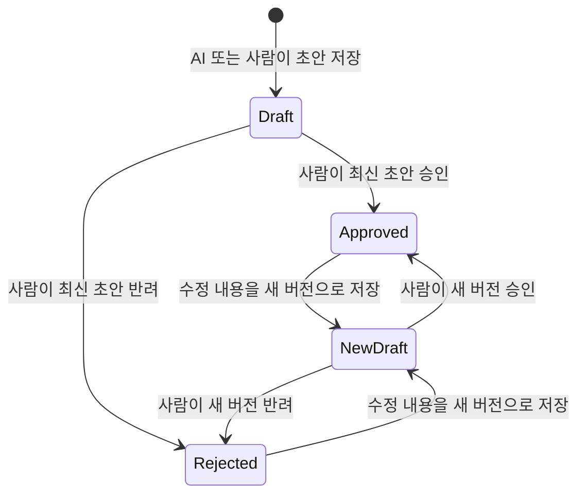
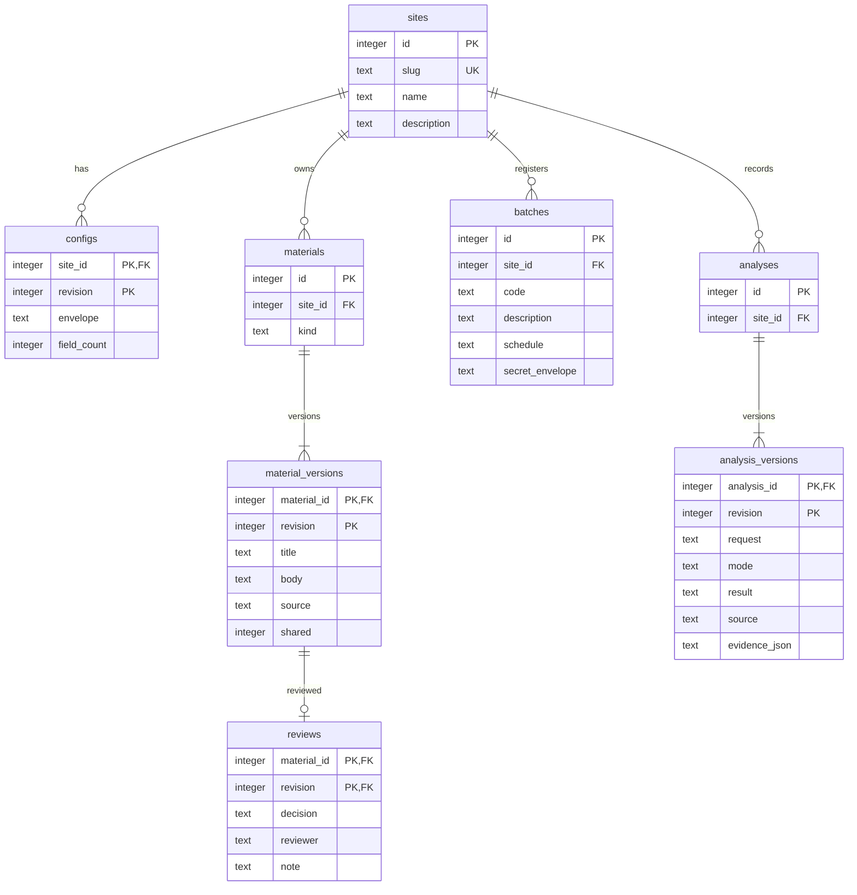

# Site Registry 아키텍처

Site Registry는 **사람이 승인한 근거를 AI에 제공하고, 분석이 어떤 근거를 사용했는지 기록하는 계층**입니다. AI 분석은 Claude Code가 수행하며, 이 앱 안에 모델이나 자동 판정 엔진은 없습니다.



## 구성과 데이터 흐름



웹 서버와 MCP는 별도 프로세스이며 같은 DB를 사용합니다. MCP는 복호화 키를 로딩하지 않습니다. 초기화와 5개 도구를 위한 작은 MCP stdio 구현이며, HTTP MCP나 분산 시스템은 아닙니다.

| 계층 | 책임 |
|---|---|
| 사람 | 근거 내용과 출처를 확인하고 특정 버전을 승인·반려 |
| Skill | 요구사항·리스크를 어떤 기준과 순서로 검토할지 안내 |
| Claude Code | 승인 근거와 접근 가능한 코드·문서를 분석하고 결과 작성 |
| MCP | 고정한 사이트의 승인 자료 조회와 초안·분석 저장 |
| Store | 사이트 경계, 버전 충돌, 승인 상태, 근거 스냅샷, 암호화 검증 |
| SQLite | 근거·검토·설정·배치·분석 이력 보존 |

## 근거와 검토 기준

자료 종류는 `feature`, `criterion`, `policy`, `document`, `raw_data`입니다. `criterion`은 근거를 바라보는 관점과 확인 항목이고, 나머지는 판단에 사용하는 업무 정의·정책·자료입니다.

기능 정의의 `body`는 다음 JSON입니다.

```json
{
  "summary": "승인 이벤트의 중복 의심 여부를 검토하는 기능",
  "rules": ["같은 주문번호와 승인번호를 확인한다.", "금액만으로 확정하지 않는다."],
  "related_ids": [1, 2]
}
```

`related_ids`는 같은 사이트 자료 ID만 연결합니다. 기능맵은 승인·공유된 자료를 노드로, 승인된 기능 정의가 참조하는 승인·공유 자료를 간선으로 제공합니다. 관계는 자료 ID에 대한 연결이며, 간선 자체가 대상의 특정 버전을 고정하지는 않습니다. 분석 기록에서 별도로 정확한 버전과 내용을 고정합니다.

이는 JSON 근거 맵이며, 임베딩 검색·Graph RAG·그래프 추론을 구현한 것은 아닙니다.

## 승인과 버전



그림의 전이는 기존 레코드 수정이 아니라 **새 버전 추가와 버전별 검토 기록**입니다.

- 한 자료의 가장 높은 승인 버전을 기준본으로 선택합니다. 해당 승인 버전이 공유 상태여야 MCP에 제공합니다.
- v1 승인 후 v2 초안이나 반려본이 생겨도 v1이 기준으로 남습니다. v2 승인 후에는 v2가 기준입니다.
- 승인·반려 기록은 특정 버전에 묶이며 변경하지 않습니다. 최신 초안만 검토할 수 있습니다.
- 수정은 `base_revision`이 최신 저장본과 일치해야 합니다. 승인본과 최신 저장본이 다를 수 있으므로 둘을 구분합니다.
- 기존 승인 취소·삭제·운영 롤백 기능은 없습니다. 공유하지 않는 새 버전을 승인하면 MCP 기준 자료에서 제외되지만, 과거 분석의 스냅샷은 유지됩니다.
- 공유 상태는 저장 계층과 API에서 관리합니다. 현재 웹 화면의 신규·수정 자료는 공유 대상으로 저장하며, 공유 여부를 바꾸는 화면은 없습니다.
- 검토자 이름은 자기 기입이며 로그인·역할별 권한 검증은 없습니다. 단일 사용자 로컬 검토 시연입니다.

## 분석 이력

요구사항·리스크 분석은 요청, 모드(`requirement`/`risk`), 결과, 분석 출처와 버전을 보관합니다. 참조는 같은 사이트에서 승인·공유된 정확한 `{material_id, revision}`만 허용합니다.

저장할 때 제목·본문·출처·종류·검토자·승인 시각을 스냅샷으로 함께 보관합니다. 이후 근거의 새 버전이 승인돼도 과거 분석이 사용한 내용은 바뀌지 않습니다. 분석 결과가 근거로 자동 승격되지는 않습니다.

## 데이터 모델: 8개 테이블



시각 컬럼은 그림을 간소화하기 위해 생략했습니다.

`reviews`는 `(material_id, revision)`에 대한 복합 외래키입니다. `analysis_versions.evidence_json`은 검증한 참조와 본문 스냅샷을 JSON으로 보관하며, 참조별 별도 테이블이나 외래키는 없습니다. 저장할 때 Store가 사이트·승인·공유 상태를 확인합니다.

## 비밀값과 공개 정보의 경계

- config 전체와 배치의 `secrets`를 암호화해 보관합니다. 설정은 버전별로, 배치는 식별자별로 인증 데이터를 묶습니다.
- MCP에는 공개 사이트 정보, 공개 배치 정보, 승인·공유된 근거만 제공합니다. 비밀 키·설정값·암호문은 반환하지 않습니다.
- 근거 본문·출처·분석 기록은 평문입니다. 본문에 비밀을 적으면 그 내용은 암호화 설정의 보호 대상이 아닙니다.
- MCP는 초안과 분석을 쓰지만 승인·설정·배치 관리 도구가 없습니다. SQLite 파일 자체는 쓰기 가능하며, 같은 OS 사용자로 파일에 직접 접근하는 프로그램까지 격리하지 않습니다.

## 이전 데이터와 구현 경계

기존 v0.1 데이터를 유지하고 추가 테이블을 생성합니다. 이전 자료에는 승인 기록이 없으므로 사람이 승인하기 전까지 MCP 기준 근거에 포함하지 않습니다. 데모는 빈 DB에만 처음 입력하며 기존 자료를 덮어쓰지 않습니다.

Node.js 24 표준 라이브러리와 SQLite로 구성합니다. KMS, 인증, 권한, 운영 감사, 모델 API, RAG 검색, 배치 실행, 운영 기능 변경, 승인 취소는 구현하지 않았습니다. 가상 데이터에서 실제 Claude Code 연결·분석 저장과 8문항의 응답 비교를 검증했습니다. [검증 보고서](evaluation.md)의 범위를 넘어 실제 업무 자료의 분석 품질을 보증하지 않습니다.
